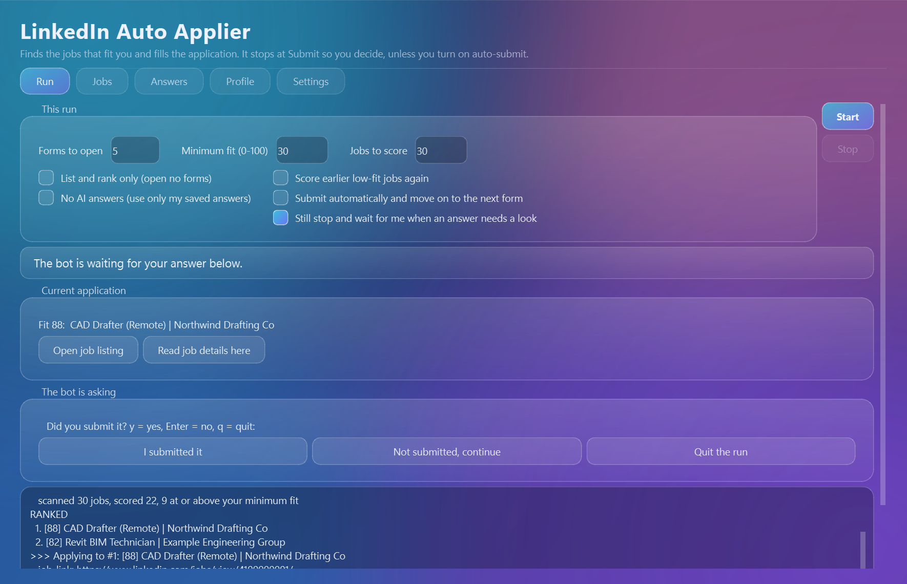
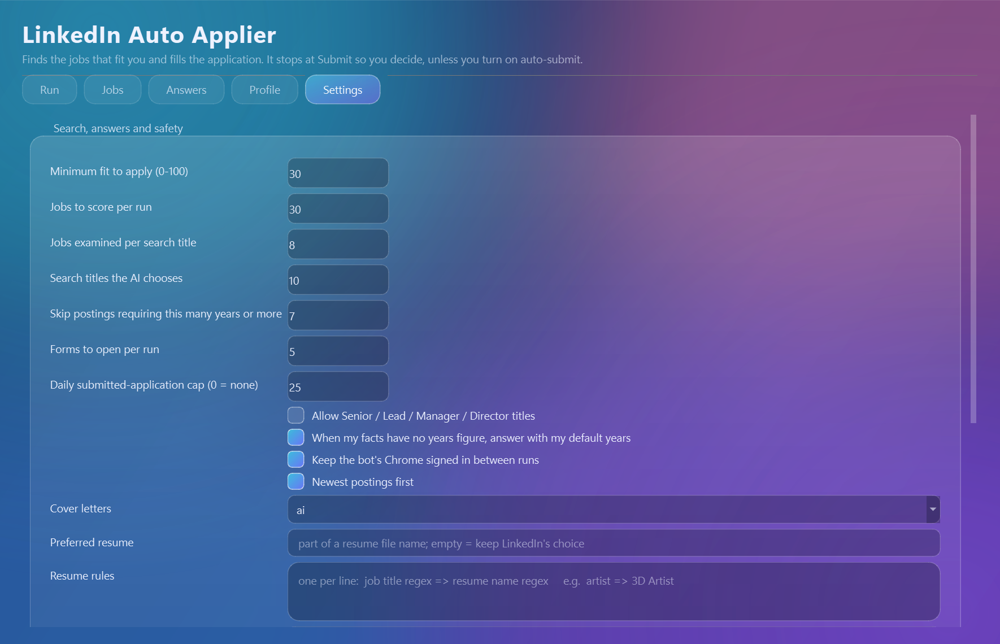
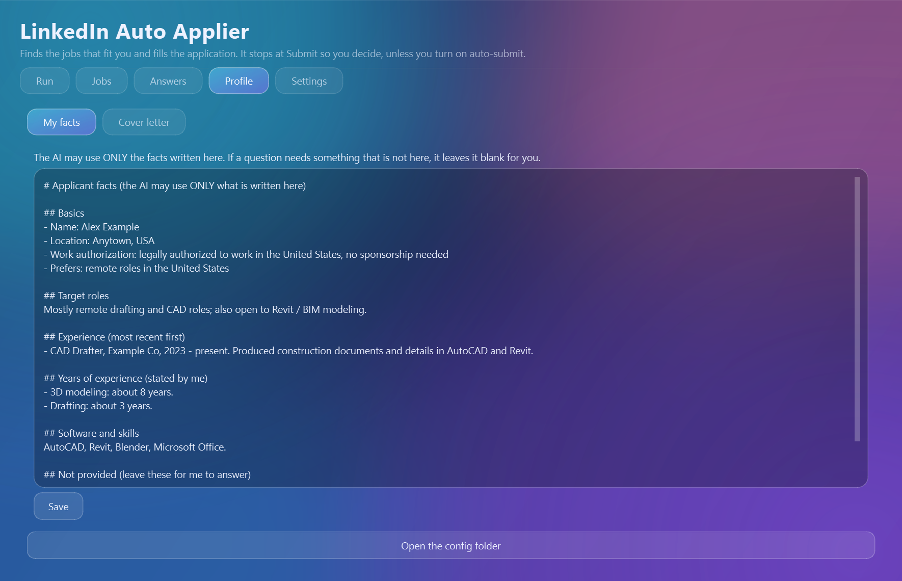
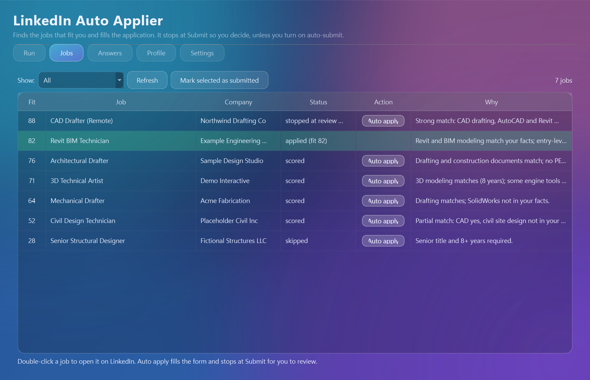
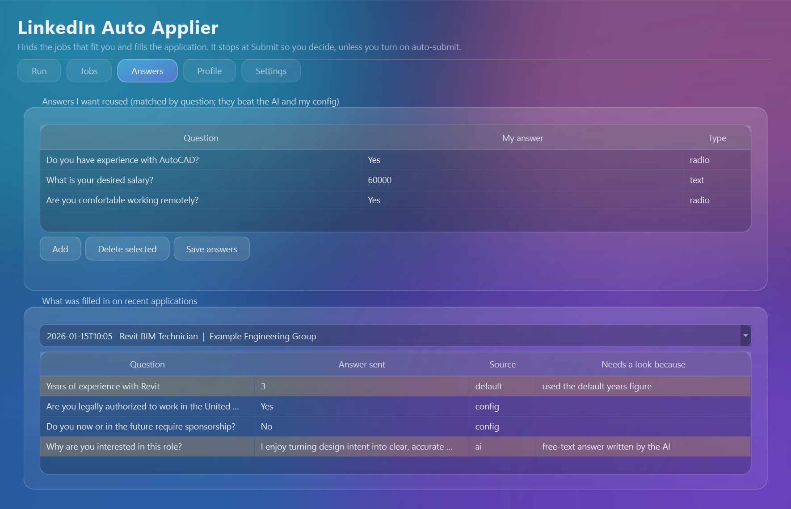

# LinkedIn Auto Applier

A Windows desktop app that helps you with LinkedIn **Easy Apply**. It finds remote, US-based Easy Apply jobs that fit you, scores each one
against **your own facts**, opens the application, fills in what it can, and then **stops at the Submit page so you read it and submit it yourself**.
By default it never clicks Submit. An optional, off-by-default **auto-submit** mode can submit for you and move on to the next form (see [Auto-submit](#auto-submit-optional-off-by-default)).



> The screenshots use made-up demo data (an invented applicant and invented companies), not a real person.

## Disclaimer

**No information is collected.** This app has no server, accounts, analytics or telemetry, and it does not send anything to the author or to any
third party. Everything it creates stays on your computer:

- your profile, answers, history, resume and the bot's Chrome profile live in the app's own folder;
- your keys and optional LinkedIn login are kept in the **Windows Credential Manager** (never in a file or in git);
- the only network traffic is (1) your own Chrome talking to LinkedIn and (2) job text and your facts going to the **AI provider you choose, using your own API key**
  (OpenAI by default), under that provider's terms. You pay your provider directly; a run typically costs a few cents.

**Use at your own risk.** Automating LinkedIn is against LinkedIn's User Agreement and can get an account restricted. The AI writes answers from the
facts you give it and can be wrong, so read every application before you submit it. This project is not affiliated with or endorsed by LinkedIn, OpenAI or any
other company, and comes with no warranty (see [LICENSE](LICENSE)).

## What it does

1. **Chooses search titles** from your facts (the AI proposes them; you can edit your facts any time).
2. **Searches LinkedIn** with filters: Remote, United States, Easy Apply, past month, newest first.
3. **Skips hopeless jobs by rule** (senior titles, licenses you do not have, security clearances, too many required years, companies you blocked, duplicates),
   then **scores the rest 0-100** using only your facts, and ranks them.
4. **Opens the best match and fills the form**: contact details from your settings, answers you saved, and the rest written by the AI from your facts.
   Anything your facts do not support is left for you. Cover letters are adapted from your own letter, as a PDF when a form asks for an upload.
5. **Stops at "Submit application"** and lists every answer, flagged ones first, so you can check them. (Or, only if you turn on auto-submit, submits and moves on.)
6. **Remembers your corrections** and keeps a local log of what was filled in.

## Install (about 10 minutes)

You need: **Windows 10 or 11**, **Google Chrome**, **Python 3.10 or newer** ([download](https://www.python.org/downloads/); tick *Add python.exe to PATH* in the installer),
and an **AI API key** (for example from [platform.openai.com](https://platform.openai.com/api-keys); add a few dollars of credit).

1. On this page click the green **Code** button, then **Download ZIP**, and unzip it somewhere you will keep it (for example `C:\LinkedInAutoApplier`).
   (Or, if you use git: `git clone https://github.com/XtraChase/linkedin-auto-applier.git`.)
2. Double-click **`setup.bat`**. It installs everything and opens the app. When it is done, use **`start_app.bat`** to open the app from then on.
3. Put your resume (PDF) at `all resumes\default\resume.pdf` (create the folders if they are missing).

## First-time setup in the app

**Settings tab**: paste your AI API key and click *Save to the Windows vault*. (A LinkedIn email and password are optional; you can also just sign in
in the bot's Chrome window the first time it opens.)



**Profile tab**: this is the most important step. Under *My facts*, write true facts about you: your name and location, work authorization, the roles you want,
your experience, years of experience per skill, education, tools you really use, and anything the AI must **not** claim (licenses, clearances). The AI may use **only** what is written here.
Under *Cover letter*, paste a letter you wrote; the AI keeps your voice and swaps in the company and role for each job.



Your name, phone, address and equal-opportunity answers live in `config\personals.py` and `config\questions.py` (click *Open the config folder* on the Profile tab).
Open them in Notepad and fill in your own details; the files explain each option.

## Using it

**Run tab:** press **Start**. A Chrome window opens (it keeps its own sign-in; sign in to LinkedIn the first time). The app searches, ranks and opens the best-fitting job.
When a form reaches the Submit page, the app tells you. Read the answers in the log, then submit (or close the form) in Chrome and tell the app what you did.
While a job is open, **Open job listing** shows the posting in your browser and **Read job details here** shows it in the app.

**Jobs tab:** every job seen, best fit first. Double-click one to open it on LinkedIn. Every job you have not submitted has an **Auto apply** button: it runs the same
fill-the-form flow for just that job and pauses at Submit. *Mark selected as submitted* fixes the record if you submitted something the log shows as not submitted.



**Answers tab:** answers to reuse for questions that come up again (yours always win over the AI), and a list of what was filled on recent applications. Answers that deserve a second look
(a guessed number of years, free text written by the AI) are highlighted.



When you press Start the app first checks that an AI key, your facts and a resume are set up, and tells you what is missing. The taskbar button flashes when the bot is waiting for you, and the latest run's log is kept in `logs\last_run.log`.

Tips: start with *List and rank only* to see what it finds without opening any forms; keep *Forms to open* small until you trust the answers; raise *Minimum fit* if you get weak matches.

## Auto-submit (optional, off by default)

In the Run tab, under **This run**, tick **Submit automatically and move on to the next form**. The app asks you to confirm, because from then on the bot clicks *Submit application*
itself, confirms that LinkedIn showed "Application sent", closes the confirmation and opens the next job. The setting resets every time you start the app.

- **Still stop and wait for me when an answer needs a look** (ticked by default, recommended): an application is *not* submitted automatically, and waits for you as usual, if a question was left blank,
  a years-of-experience figure was a guessed default, or the AI wrote an answer about a degree or certification, work authorization, background checks or equal-opportunity questions.
  Answers from your own settings, your saved answers and ones you typed never hold it back. Untick this box only if you accept that the AI's answers go out without you reading them.
- *Forms to open* and the *Daily submitted-application cap* in Settings still limit how many applications a run sends, and *List and rank only* never submits.
- The **Auto apply** button in the Jobs tab always stops at Submit, whatever this setting says.
- Everything sent is still recorded in the Answers tab and in `all excelsnswers_log.jsonl`.

You are responsible for every application it sends. A submitted application cannot be taken back, and automating LinkedIn can get your account restricted.

## Command line (optional)

```
start_hybrid.bat --max-jobs 3 --min-fit 30
```

Options: `--list-only`, `--no-ai`, `--retry-low`, `--any-level`, `--job <LinkedIn job id>`, `--auto-submit` (with `--no-review-pause` to skip the safety stop).

## Standalone .exe (optional)

`.venv\Scripts\python.exe build_exe.py` builds `dist\LinkedIn Auto Applier\LinkedIn Auto Applier.exe` (a folder of about 190 MB). Your personal data is **not** inside it.
The exe uses the first folder at or above itself that has `config\personals.py`, otherwise it creates a fresh config next to itself.

## When something stops working

LinkedIn changes its pages without warning. Run `.venv\Scripts\python.exe health_check.py` (or *Check LinkedIn still works* in Settings): it reads the live site without applying to anything and
says which part broke (all page selectors live in `li_selectors.py`). `pytest tests` runs the offline checks. If it needs fixing, issues and pull requests are welcome.

## Your data and privacy

These files are created for you on first run and are **git-ignored**, so they are never uploaded if you fork or commit: `config\personals.py`, `config\questions.py`, `config\profile.md`,
`config\cover_letter_template.md`, `config\answers.json`, `config\app_settings.json`, `all excels\` (job history, answers log), `all resumes\`, `.chrome_profile\`.
Only `*.example` templates are in the repository. To remove everything the app has stored, delete the app folder and the Windows Credential Manager entries for *linkedin-auto-applier* (llm_api_key, linkedin_username, linkedin_password).

## Credits and license

Derived from [GodsScion/Auto_job_applier_linkedIn](https://github.com/GodsScion/Auto_job_applier_linkedIn) by Sai Vignesh Golla. That project stopped working when LinkedIn changed its jobs pages in 2026,
so the search, job list, Easy Apply form filling and the desktop app here are new. Licensed under the MIT License (see [LICENSE](LICENSE) and [NOTICE](NOTICE)).
The original project's documentation is kept in [`docs/`](docs/README.md) for reference.
